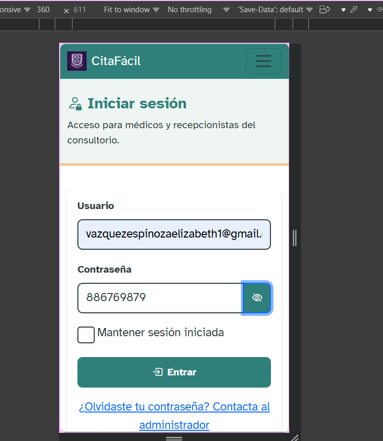

# CitaFácil
*Tu tiempo también importa*

## Sitio publicado
https://vazquezespinozaelizabeth1-lang.github.io/CitaFacil/

## Integrantes
| Integrante | Rol |
|---|---|
| Elizabeth Vázquez Espinoza | Líder de equipo |
| Corona Téllez Jonathan | Analista |
| Aram Jael Morales Peña | Backend |
| Victor Hugo Ramírez | Backend |
| Luis Ángel Ruiz Bautista | Frontend |
| Liam Tonatihu Villanueva Cerón | Frontend |

## Descripción de la aplicación
CitaFácil es una aplicación web para que consultorios pequeños gestionen sus citas: agendar, cancelar, reprogramar, consultar horarios disponibles y recibir recordatorios.

## Objetivo
Evitar citas duplicadas, olvidadas o mal organizadas mediante una interfaz simple y accesible, pensada también para personas mayores o con poca experiencia tecnológica.

## Tecnologías utilizadas
- HTML5
- CSS3
- JavaScript (DOM, eventos y funciones con nombre)
- Bootstrap 5.3 y Bootstrap Icons
- Git y GitHub (control de versiones y tablero Kanban)
- LaTeX (SRS y Guía de diseño)

## Características principales
- Sitio multipágina: 4 páginas públicas (Inicio, Nosotros, Servicios y Contacto) y un panel para el consultorio (pacientes, citas, horarios, recordatorios y usuarios)
- Interacciones dinámicas con JavaScript: validación en tiempo real, barra de progreso, modal con información dinámica, toast, filtrado de pacientes, agregar y eliminar usuarios y mostrar/ocultar contraseña
- Diseño responsive para computadora, tableta y móvil
- Formularios con validación de Bootstrap
- Interfaz sencilla y accesible

## Componentes de Bootstrap utilizados
Navbar responsive, sistema de rejilla (container, row, col), cards, carousel, accordion, modal, toast, progress, input-group, tablas, validación de formularios (`is-valid`, `is-invalid`, `invalid-feedback`), botones, badges y utilidades.

## Estructura del proyecto
```
CitaFacil/
├── index.html
├── nosotros.html
├── servicios.html
├── contacto.html
├── login.html
├── panel.html
├── pacientes-registro.html
├── pacientes-buscar.html
├── citas-agendar.html
├── citas-consulta.html
├── citas-modificar.html
├── citas-cancelar.html
├── citas-duplicada.html
├── horarios.html
├── recordatorios.html
├── usuarios.html
├── README.md
├── css/
│   └── estilos.css
├── js/
│   ├── app.js
│   ├── validacion.js
│   ├── modal-cita.js
│   ├── toast.js
│   ├── filtro.js
│   ├── usuarios.js
│   └── password.js
├── img/
│   └── (capturas e imágenes del proyecto)
└── docs/
    ├── SRS.pdf (fuente en LaTeX: SRS.tex)
    └── Guia_Diseno.pdf (fuente en LaTeX: Guia_Diseno.tex)
```

## Instrucciones para visualizarlo
1. Clonar el repositorio:
```
   git clone https://github.com/vazquezespinozaelizabeth1-lang/CitaFacil.git
```
2. Abrir la carpeta `CitaFacil`.
3. Abrir `index.html` en el navegador (doble clic) o usar la extensión Live Server en VS Code.

## Tabla de Interacciones JavaScript

| Interacción | Tipo | Responsable | Página | Selectores usados | Eventos usados | Componente Bootstrap |
|---|---|---|---|---|---|---|
| Filtrado de pacientes en tiempo real | Obligatoria | Jonathan | `pacientes-buscar.html` | `getElementById('q')`, `querySelectorAll('tbody tr')`, `querySelector('form')` | `input`, `submit` | Tabla (`table`) y utilidad `d-none` |
| Validación de formulario en tiempo real | Obligatoria | Angel | `pacientes-registro.html` | `getElementById`, `querySelectorAll` | `input`, `blur`, `submit`, `preventDefault()` | `is-valid`, `is-invalid`, `invalid-feedback` |
| Barra de progreso del registro | Libre | Angel | `pacientes-registro.html` | `getElementById` | `input` | Progress |
| Modal con información dinámica | Obligatoria | Liam | `citas-consulta.html` | `getElementById`, `querySelector` | `show.bs.modal`, `dataset` | Modal (`data-bs-*`) |
| Notificación tras una acción | Obligatoria | Victor | `citas-agendar.html`, `citas-cancelar.html` | `getElementById`, `querySelector` | `submit`, `preventDefault()` | Toast |
| Agregar y eliminar usuarios | Obligatoria | Aram | `usuarios.html` | `getElementById`, `querySelector` | `submit`, `click` (delegación de eventos) | Tabla, badge, botones |
| Mostrar/ocultar contraseña | Libre | Elizabeth | `login.html` | `getElementById`, `querySelector` | `click` | Input-group |

## Reflexión por integrante

Cada integrante responde: ¿qué fue lo más difícil de su interacción?, ¿qué aprendió al combinar JavaScript con Bootstrap? y, en el caso de la delegación de eventos, ¿qué ventaja ofrece?

### Elizabeth Vázquez Espinoza (Líder) · Mostrar/ocultar contraseña
Lo más difícil fue coordinar al equipo: repartir las interacciones, revisar los Pull Requests y hacer los merges sin conflictos. Mi interacción (mostrar/ocultar contraseña) me enseñó a cambiar el `type` del input y el ícono con `classList`, usando `input-group` de Bootstrap sin `style` en línea.

### Corona Téllez Jonathan (Analista) · Filtrado de pacientes
Implementar el filtro en tiempo real me ayudó a dominar la manipulación del DOM y el uso de eventos como `input` combinados con clases de Bootstrap. Adaptarme al flujo de trabajo con ramas en Git y el tablero Kanban fue clave para mantener la organización y coordinar entregas de calidad con el equipo.

### Aram Jael Morales Peña (Backend) · Agregar y eliminar usuarios
Lo más difícil fue implementar la función para agregar y eliminar usuarios, porque tenía que validar que las contraseñas coincidieran y asegurar que los botones funcionaran correctamente. Aprendí a combinar JavaScript con Bootstrap para crear filas dinámicamente y utilizar sus clases para dar estilo a los botones y estados. La ventaja de la delegación de eventos es que permite eliminar usuarios nuevos y existentes con un solo listener, sin agregar un evento a cada botón.

### Victor Hugo Ramírez (Backend) · Toast de notificación
Lo difícil fue recordar cada cosa (rama, commits, push y PR) y revisar que los ids del HTML coincidieran con los que usaba el JavaScript, porque si no coinciden el toast no muestra bien los datos. Aprendí que Bootstrap pone el estilo y la estructura, pero el JavaScript es el que lo activa (`bootstrap.Toast.getOrCreateInstance`) y que con `classList` puedo cambiar el color del toast sin usar `style` en línea.

### Luis Ángel Ruiz Bautista (Frontend) · Validación en tiempo real y barra de progreso
Lo más difícil fue lograr que la validación se viera en tiempo real y que la barra de progreso avanzara solo con los campos válidos, usando clases de Bootstrap (`w-25`, `w-50`, etc.) en lugar de `style` en línea. Aprendí que Bootstrap da los estados visuales (`is-valid`, `is-invalid`, `invalid-feedback`) y que JavaScript decide cuándo aplicarlos con `classList` y `checkValidity()`.

### Liam Tonatihu Villanueva Cerón (Frontend) · Modal con información dinámica
Lo más difícil fue que un solo modal mostrara información distinta según el botón, leyendo los datos con `dataset` y el evento `show.bs.modal`, cuidando que los `data-*` coincidieran con lo que leía el JavaScript. Aprendí que Bootstrap abre y cierra el modal, pero JavaScript es quien le da el contenido dinámico.

## Capturas de pantalla

### Interacciones JavaScript (Práctica 1)

**Validación en tiempo real y barra de progreso**


**Modal con información dinámica**


**Toast tras una acción**


**Filtrado de pacientes**


**Agregar y eliminar usuarios**


**Mostrar/ocultar contraseña**



### Pruebas de diseño responsive (móvil)


## Evidencias del proceso

### Repositorio en GitHub


### Tablero Kanban


**Entrega anterior**


**Práctica 1 (interacciones con DOM y Bootstrap)**


### Colaboradores del repositorio


### Ramas


### Historial de commits

