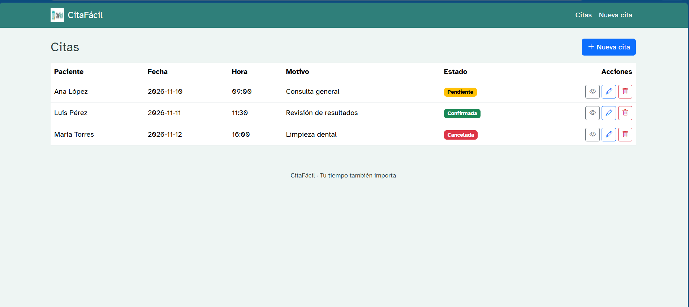
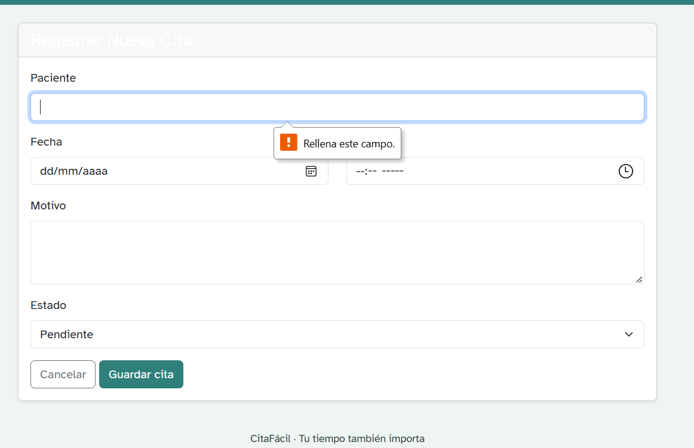
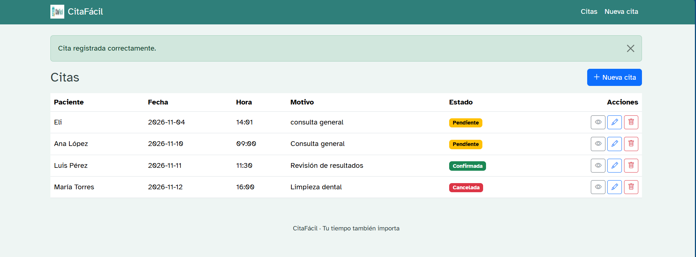
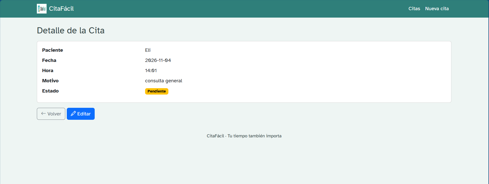
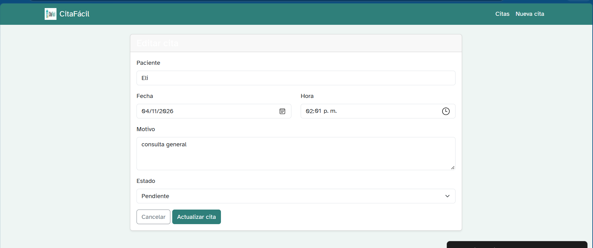
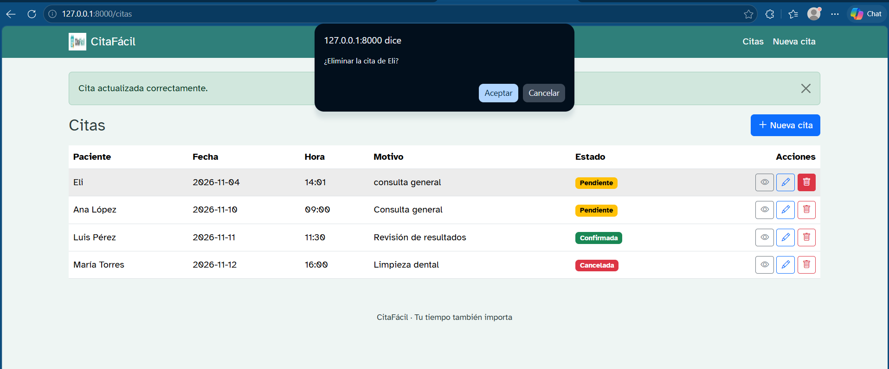
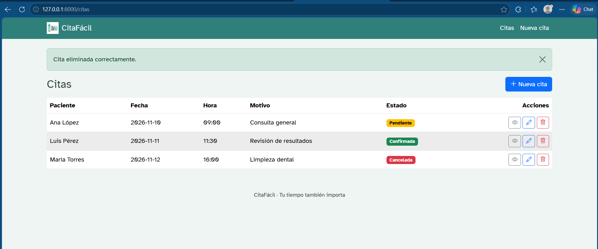
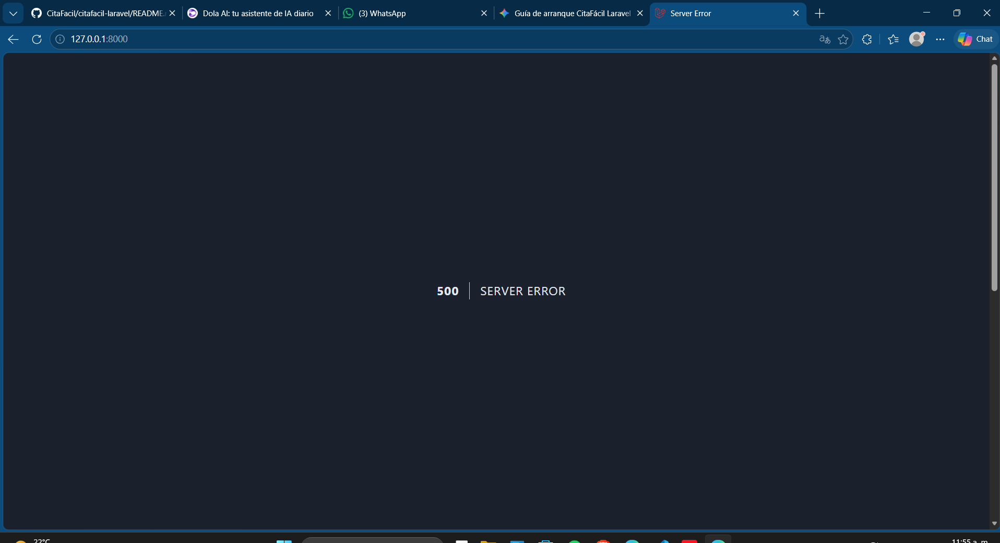
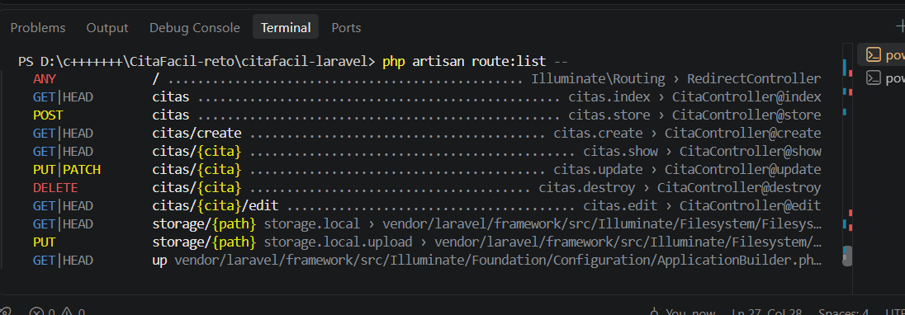
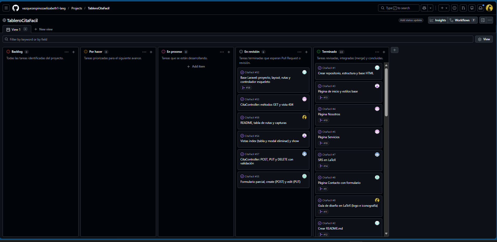

# CitaFácil · Módulo de Citas (Laravel 12)
*Tu tiempo también importa.*
# CitaFácil · Módulo de Citas (Laravel 12)
*Tu tiempo también importa.*

## 1. Descripción
CitaFácil es una aplicación web desarrollada en Laravel para la gestión eficiente de citas médicas y atención al paciente.

## 2. Tecnologías
- PHP 8.3+
- Laravel 12
- Bootstrap 5
- MySQL

## Integrantes
| Integrante | Rol | Usuario de GitHub | Rama |
|---|---|---|---|
| Elizabeth Vázquez Espinoza | Líder | vazquezespinozaelizabeth1-lang | feature/base-laravel |
| Jonathan Corona Téllez | Analista | jonathancorona-rgb | feature/readme-docs |
| Aram Jael Morales Peña | Backend | arammorales | feature/rutas-controller-get |
| Victor Hugo Ramírez | Backend | petevictor1-maker | feature/controller-post-put-delete |
| Luis Ángel Ruiz Bautista | Frontend | angelrb2531126237 | feature/vistas-index-show |
| Liam Tonatihu Villanueva Cerón | Frontend | LiamVillanueva777 | feature/vistas-create-edit |

## 4. Instalación
1. Clonar el repositorio: `git clone <URL-del-repositorio>`
2. Entrar al proyecto: `cd citafacil-laravel`
3. Instalar dependencias: `composer install --ignore-platform-reqs`
4. Copiar el archivo de entorno: `cp .env.example .env`
5. Generar la clave de la aplicación: `php artisan key:generate`
6. Iniciar el servidor local: `php artisan serve`

## 5. Tabla de rutas
| Método | URI | Nombre | Controlador@Método | Descripción |
| :--- | :--- | :--- | :--- | :--- |
| `GET` | `/` | — | Redirect | Redirige automáticamente a la lista de citas (`/citas`) |
| `GET` | `citas` | `citas.index` | `CitaController@index` | Muestra el listado de todas las citas agendadas |
| `GET` | `citas/create` | `citas.create` | `CitaController@create` | Muestra el formulario para agendar una nueva cita |
| `POST` | `citas` | `citas.store` | `CitaController@store` | Procesa y guarda la nueva cita en el sistema |
| `GET` | `citas/{cita}` | `citas.show` | `CitaController@show` | Muestra el detalle completo de una cita específica |
| `GET` | `citas/{cita}/edit` | `citas.edit` | `CitaController@edit` | Muestra el formulario para editar una cita existente |
| `PUT` | `citas/{cita}` | `citas.update` | `CitaController@update` | Actualiza la información de la cita en el sistema |
| `DELETE` | `citas/{cita}` | `citas.destroy` | `CitaController@destroy` | Elimina una cita registrada |

## 6. Métodos HTTP aplicados
- **GET:** Utilizado para consultar el listado de citas, formularios de registro/edición y vistas de detalle.
- **POST:** Empleado para el envío de datos e inserción de nuevas citas en la base de datos.
- **PUT:** Aplicado para actualizar registros existentes de citas.
- **DELETE:** Utilizado para remover registros de citas del sistema.

## 7. Notas
- Se requiere el uso del parámetro `--ignore-platform-reqs` al ejecutar `composer install` si la versión local de PHP difiere de la especificada en el archivo `composer.lock`.

## 8. Capturas de pantalla












## Instalación
```bash
git clone [https://github.com/vazquezespinozaelizabeth1-lang/CitaFacil.git](https://github.com/vazquezespinozaelizabeth1-lang/CitaFacil.git)
cd CitaFacil/citafacil-laravel
composer install
cp .env.example .env
php artisan key:generate
php artisan servegit status
