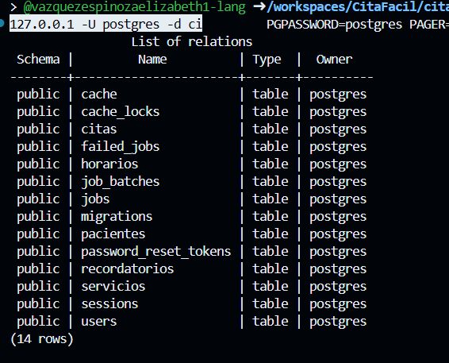
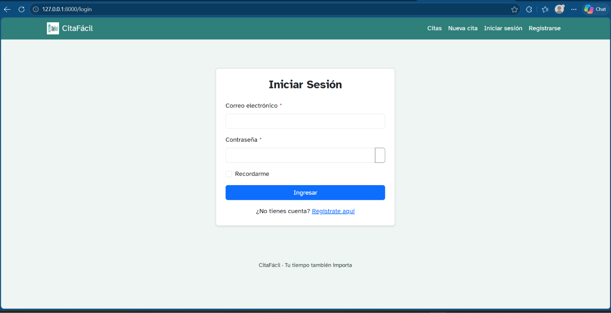
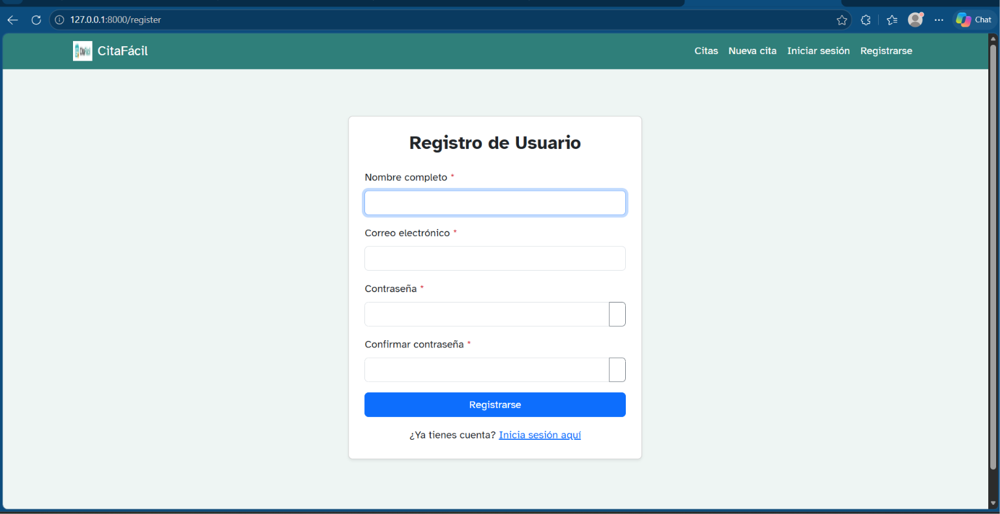
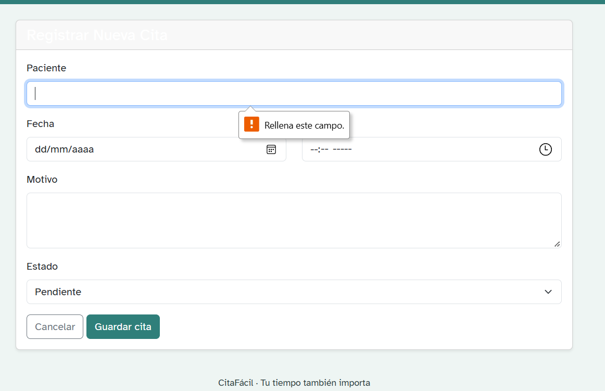
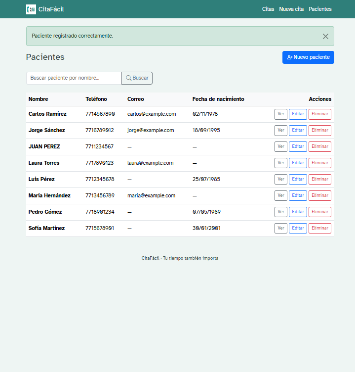
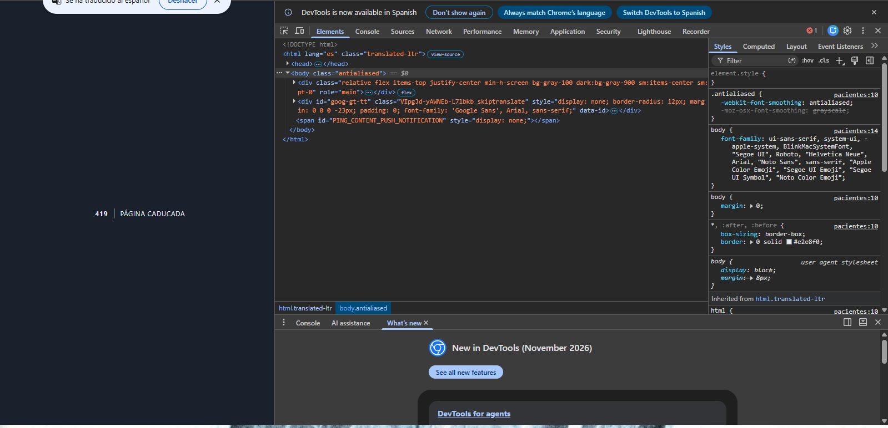
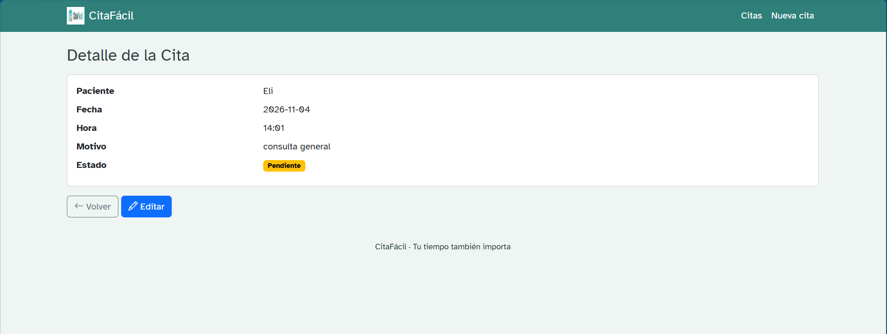
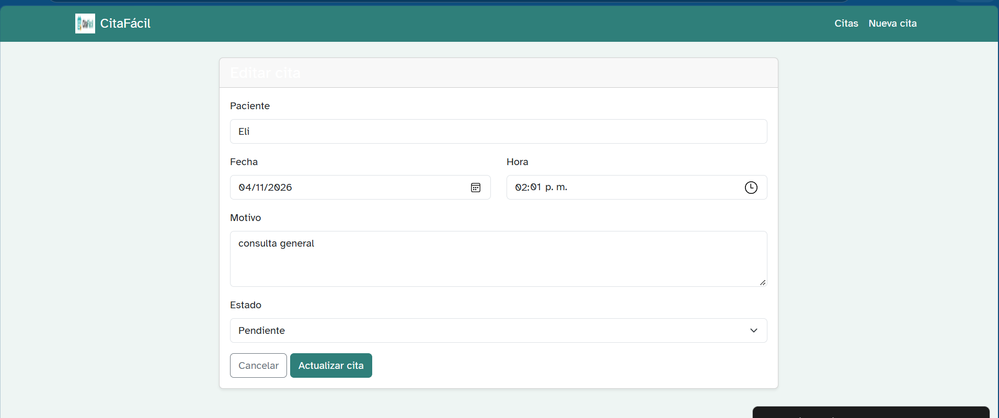
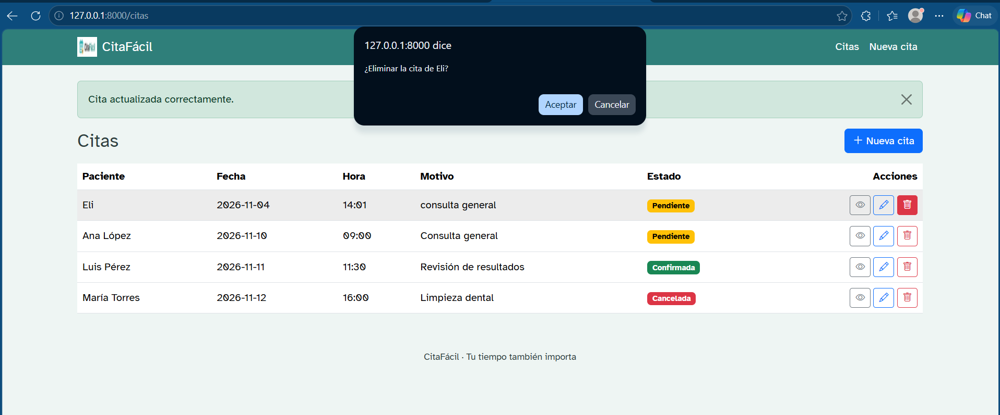
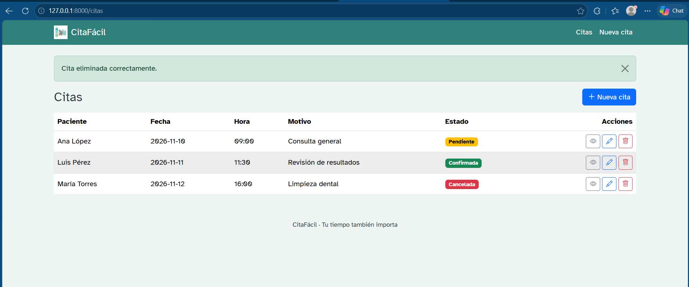

# CitaFácil · Aplicación web de citas (Laravel 12 + PostgreSQL)
*Tu tiempo también importa.*

## 1. Descripción
CitaFácil es una aplicación web para que consultorios pequeños gestionen sus citas: pacientes, servicios, horarios, citas y recordatorios, con inicio de sesión y roles. Está desarrollada con Laravel 12 y PostgreSQL.

> Estado: en desarrollo. Cada integrante completa en este README la sección de su módulo.

## 2. Tecnologías
- PHP 8.2 o superior (con las extensiones `pdo_pgsql` y `pgsql`)
- Laravel 12
- PostgreSQL
- Bootstrap 5
- Composer, Git y GitHub

## 3. Integrantes
| Integrante | Rol | Usuario de GitHub | Módulo | Tarjetas |
|---|---|---|---|---|
| Elizabeth Vázquez Espinoza | Desarrolladora | vazquezespinozaelizabeth1-lang | Entorno y base de datos | T01, T02, T17 |
| Jonathan Corona Téllez | Desarrollador | jonathancorona-rgb | Autenticación, roles y errores | T05, T12, T13 |
| Aram Jael Morales Peña | Desarrollador | arammorales | Citas y panel | T09, T11 |
| Victor Hugo Ramírez | Desarrollador | petevictor1-maker | Servicios, horarios y producción | T07, T08, T14 |
| Luis Ángel Ruiz Bautista | Desarrollador | angelrb2531126237 | Layout, logo y recordatorios | T03, T10, T15 |
| Liam Tonatihu Villanueva Cerón | Desarrollador | LiamVillanueva777 | Componentes, pacientes y seguridad | T04, T06, T16 |

## 4. Instalación

### Requisitos
- PHP 8.2 o superior con `pdo_pgsql` y `pgsql` activos (`php -m | grep -i pgsql`)
- Composer
- PostgreSQL

### Pasos
1. Clonar el repositorio y entrar a la app:
```bash
git clone https://github.com/vazquezespinozaelizabeth1-lang/CitaFacil.git
cd CitaFacil/citafacil-laravel
```
2. Instalar dependencias:
```bash
composer install
```
3. Crear la base de datos `citafacil` en PostgreSQL (con pgAdmin, o con `createdb -U postgres citafacil`).
4. Copiar el archivo de entorno y editarlo:
```bash
cp .env.example .env
```
Abre `.env` y escribe tu usuario y contraseña de PostgreSQL en `DB_USERNAME` y `DB_PASSWORD`. El archivo `.env` es personal y nunca se sube al repositorio.
5. Generar la clave, crear las tablas y cargar los datos de ejemplo:
```bash
php artisan key:generate
php artisan migrate --seed
```
6. Iniciar el servidor:
```bash
php artisan serve
```
Abre http://127.0.0.1:8000

### Problemas comunes
| Error | Solución |
|---|---|
| `could not find driver` | Activa `pdo_pgsql` y `pgsql` en `php.ini` (o instala el paquete `php-pgsql`) y abre una terminal nueva |
| `password authentication failed` | Revisa `DB_USERNAME` y `DB_PASSWORD` en `.env` y ejecuta `php artisan config:clear` |
| `database "citafacil" does not exist` | Crea la base de datos (paso 3) |

## 5. Estructura del proyecto
- `app/Http/Controllers`: controladores delgados, uno por módulo
- `app/Http/Requests`: validación (FormRequest de store y update por módulo)
- `app/Models`: modelos Eloquent con relaciones
- `database/migrations` y `database/seeders`: esquema y datos de ejemplo
- `resources/views`: vistas Blade, una carpeta por módulo, más `layouts` y `partials`
- `routes/web.php`: rutas del sistema

## 6. Módulos
Cada sección la completa su responsable: descripción, rutas, reglas de validación y capturas.

<!-- INICIO: Base de datos -->
### Base de datos

CitaFácil usa PostgreSQL. Todo el esquema se crea con migraciones y se llena con seeders.

    php artisan migrate:fresh --seed

#### Tablas

| Tabla | Descripción | Relaciones |
|---|---|---|
| users | Usuarios del sistema; columna `role` (`admin` o `recepcion`, por defecto `recepcion`) | |
| pacientes | Nombre, teléfono, email (único, opcional) y fecha de nacimiento | Tiene muchas citas |
| servicios | Nombre (único), descripción, duración en minutos, precio `decimal(8,2)` y `activo` (boolean) | Tiene muchas citas |
| horarios | Día de la semana (1 a 7), hora de inicio y fin, `activo`; único por día y hora de inicio | |
| citas | Fecha, hora, motivo y estado (Pendiente, Confirmada o Cancelada) | Pertenece a un paciente y a un servicio; tiene muchos recordatorios |
| recordatorios | Mensaje, fecha de envío, canal (correo, sms o whatsapp) y `enviado` (boolean) | Pertenece a una cita |

#### Política de borrado

- Un paciente o un servicio con citas **no se puede borrar** (`restrictOnDelete`).
- Al borrar una cita se borran sus recordatorios (`cascadeOnDelete`).

#### Datos de ejemplo

El seeder crea un administrador (credenciales en `.env.example`), 8 pacientes, 4 servicios, horarios de lunes a viernes, 10 citas y 5 recordatorios.




<!-- FIN: Base de datos -->

<!-- INICIO: Interfaz y layout -->
### Interfaz y layout

El layout compartido `resources/views/layouts/app.blade.php` usa el logo de CitaFácil como marca del navbar y favicon. El logo se muestra a 40 px de alto, conserva su proporción y tiene fondo blanco. El navbar usa el verde institucional, se puede expandir en móvil y marca la sección activa con `aria-current="page"`. El pie de página muestra el año actual.

| Enlace | Ruta de Laravel |
| --- | --- |
| Panel | `panel` |
| Citas | `citas.index` |
| Pacientes | `pacientes.index` |
| Servicios | `servicios.index` |
| Horarios | `horarios.index` |
| Recordatorios | `recordatorios.index` |
| Iniciar sesión | `login` |
| Registrarse | `register` |
| Cerrar sesión | `logout` |

Cada enlace se muestra cuando existe su ruta. La zona de usuario muestra el nombre de la persona autenticada y, cuando está disponible, un formulario de cierre de sesión por POST con CSRF.


<!-- FIN: Interfaz y layout -->

<!-- INICIO: Componentes compartidos -->
### Componentes compartidos
*Pendiente: la completa Liam (T04).*
<!-- FIN: Componentes compartidos -->

<!-- INICIO: Autenticación -->
### Autenticación

**Flujo**
1. El visitante entra a `/login` o `/register` (solo invitados).
2. Al registrarse, se crea el usuario y se inicia sesión automáticamente.
3. Al iniciar sesión se redirige a la página que intentaba abrir, o al listado de citas.
4. `POST /logout` cierra la sesión e invalida el token.

**Rutas**

| Método | Ruta | Nombre | Acceso |
|--------|------|--------|--------|
| GET | `/login` | `login` | invitados |
| POST | `/login` | – | invitados (máx. 5 intentos por minuto) |
| GET | `/register` | `register` | invitados |
| POST | `/register` | – | invitados |
| POST | `/logout` | `logout` | autenticados |

**Capturas**



<!-- FIN: Autenticación -->

<!-- INICIO: Roles y permisos -->
### Roles y permisos
*Pendiente: la completa Jonathan (T12).*
<!-- FIN: Roles y permisos -->

<!-- <!-- INICIO: Pacientes -->
### Pacientes
Módulo CRUD completo para la gestión de pacientes conectado a PostgreSQL mediante Eloquent (`App\Models\Paciente`). Incluye búsqueda por nombre (`scopeBuscar`), paginación con conservación de filtros (`paginate(10)->withQueryString()`), consulta del historial de citas del paciente y bloqueo de eliminación cuando existen citas asociadas.

#### Reglas de validación (`StorePacienteRequest` / `UpdatePacienteRequest`)
- `nombre`: obligatorio, texto, entre 3 y 100 caracteres.
- `telefono`: obligatorio, exactamente 10 dígitos (`digits:10`).
- `email`: opcional, formato de correo válido, máximo 100 caracteres, único en `pacientes` (ignorando el registro actual al actualizar).
- `fecha_nacimiento`: opcional, fecha válida anterior a hoy (`before:today`).
<!-- FIN: Pacientes -->

<!-- INICIO: Servicios -->
### Servicios
*Pendiente: la completa Victor (T07).*
<!-- FIN: Servicios -->

<!-- INICIO: Horarios -->
### Horarios
*Pendiente: la completa Victor (T08).*
<!-- FIN: Horarios -->

<!-- INICIO: Citas -->
### Citas
*Pendiente: la completa Aram (T09).*
<!-- FIN: Citas -->

<!-- INICIO: Recordatorios -->
### Recordatorios

El módulo registra, lista, consulta, edita y elimina avisos programados para las citas. Cada recordatorio pertenece a una cita de PostgreSQL y muestra al paciente asociado. Al eliminar la cita en PostgreSQL, su clave foránea elimina los recordatorios en cascada. El envío real por correo, SMS o WhatsApp queda fuera de esta entrega.

| Método | Ruta | Acción |
| --- | --- | --- |
| GET | `/recordatorios` | Listar y filtrar |
| GET | `/recordatorios/create` | Abrir el formulario de creación |
| POST | `/recordatorios` | Guardar |
| GET | `/recordatorios/{recordatorio}` | Consultar el detalle |
| GET | `/recordatorios/{recordatorio}/edit` | Abrir el formulario de edición |
| PUT / PATCH | `/recordatorios/{recordatorio}` | Actualizar |
| DELETE | `/recordatorios/{recordatorio}` | Eliminar tras confirmar |

La cita debe existir en `citas`. El mensaje es obligatorio y admite de 5 a 255 caracteres. La fecha y hora de envío son obligatorias y usan el formato `AAAA-MM-DDTHH:MM` del control `datetime-local`. El canal es obligatorio y se valida con `Recordatorio::CANALES` (Correo, SMS y WhatsApp). La casilla Enviado se guarda como valor booleano.

Los filtros por canal y estado se pueden combinar. Pendiente corresponde a `enviado=0`; Enviado corresponde a `enviado=1`. El listado muestra diez registros por página y conserva los filtros al navegar. **Limpiar filtros** vuelve al listado completo.

| Pantalla | Escritorio a 1280 px | Móvil a 375 px |
| --- | --- | --- |
| Listado | [Ver captura](docs/capturas/t10/listado-escritorio.png) | [Ver captura](docs/capturas/t10/listado-movil.png) |
| Creación | [Ver captura](docs/capturas/t10/creacion-escritorio.png) | [Ver captura](docs/capturas/t10/creacion-movil.png) |
| Edición | [Ver captura](docs/capturas/t10/edicion-escritorio.png) | [Ver captura](docs/capturas/t10/edicion-movil.png) |
| Detalle | [Ver captura](docs/capturas/t10/detalle-escritorio.png) | [Ver captura](docs/capturas/t10/detalle-movil.png) |
| Confirmación de eliminación | [Ver captura](docs/capturas/t10/modal-escritorio.png) | [Ver captura](docs/capturas/t10/modal-movil.png) |

Las pruebas de `tests/Feature/RecordatorioTest.php` cubren el CRUD, las validaciones, la recuperación de valores, los filtros, la paginación y la cascada.

<!-- FIN: Recordatorios -->

<!-- INICIO: Panel -->
### Panel
*Pendiente: la completa Aram (T11).*
<!-- FIN: Panel -->

<!-- INICIO: Páginas de error -->
### Páginas de error
*Pendiente: la completa Jonathan (T13).*
<!-- FIN: Páginas de error -->

<!-- INICIO: Seguridad -->
### Seguridad
*Pendiente: la completa Liam (T16).*
<!-- FIN: Seguridad -->

<!-- INICIO: Revisión de interfaz -->
### Revisión de interfaz
*Pendiente: la completa Angel (T15).*
<!-- FIN: Revisión de interfaz -->

<!-- INICIO: Despliegue -->
### Despliegue
*Pendiente: la completa Victor (T14).*
<!-- FIN: Despliegue -->

## 7. Tabla de rutas
Se amplía con cada módulo. Rutas actuales:

| Método | URI | Nombre | Controlador@Método | Descripción |
| :--- | :--- | :--- | :--- | :--- |
| `GET` | `/` | — | Redirect | Redirige a la lista de citas (`/citas`) |
| `GET` | `citas` | `citas.index` | `CitaController@index` | Listado de citas |
| `GET` | `citas/create` | `citas.create` | `CitaController@create` | Formulario para agendar una cita |
| `POST` | `citas` | `citas.store` | `CitaController@store` | Guarda la nueva cita |
| `GET` | `citas/{cita}` | `citas.show` | `CitaController@show` | Detalle de una cita |
| `GET` | `citas/{cita}/edit` | `citas.edit` | `CitaController@edit` | Formulario de edición |
| `PUT` | `citas/{cita}` | `citas.update` | `CitaController@update` | Actualiza la cita |
| `DELETE` | `citas/{cita}` | `citas.destroy` | `CitaController@destroy` | Elimina la cita |
| `GET` | `pacientes` | `pacientes.index` | `PacienteController@index` | Listado de pacientes con búsqueda y paginación |
| `GET` | `pacientes/create` | `pacientes.create` | `PacienteController@create` | Formulario para registrar un paciente |
| `POST` | `pacientes` | `pacientes.store` | `PacienteController@store` | Guarda un nuevo paciente |
| `GET` | `pacientes/{paciente}` | `pacientes.show` | `PacienteController@show` | Detalle del paciente y sus citas |
| `GET` | `pacientes/{paciente}/edit` | `pacientes.edit` | `PacienteController@edit` | Formulario de edición del paciente |
| `PUT` | `pacientes/{paciente}` | `pacientes.update` | `PacienteController@update` | Actualiza los datos del paciente |
| `DELETE` | `pacientes/{paciente}` | `pacientes.destroy` | `PacienteController@destroy` | Elimina el paciente (si no tiene citas) |

## 8. Capturas de pantalla



---

## Auditoría de Validación y Seguridad (T16)

Se realizó la revisión integral de seguridad y validación sobre el proyecto **CitaFácil** (Laravel 12 + PostgreSQL):

| Control de Seguridad | Estado | Evidencia / Implementación |
| :--- | :---: | :--- |
| **FormRequests independientes** | Cumple | `StorePacienteRequest` y `UpdatePacienteRequest` heredan de `BaseFormRequest` con reglas dedicadas (`unique` ignorando el ID actual al editar) y mensajes en español. |
| **Protección CSRF** | Cumple | Todos los formularios `POST`, `PUT` y `DELETE` incluyen `@csrf` y `@method(...)`. Peticiones sin token devuelven `419 Page Expired`. |
| **Prevención XSS** | Cumple | Sanitización automática en `BaseFormRequest` (`strip_tags`) y escape nativo `{{ }}` en vistas Blade (sin uso de `{!! !!}`). |
| **Mass Assignment** | Cumple | Todos los modelos (`Cita`, `Horario`, `Paciente`, `Recordatorio`, `Servicio`, `User`) definen `$fillable` explícito; `User` excluye `role` y los controladores usan `$request->validated()`. |
| **Prevención SQL Injection** | Cumple | Consultas exclusivas mediante Eloquent ORM y parámetros vinculados (sin `DB::raw` ni `whereRaw`). |

### Evidencias de pruebas manuales

- **Sanitización XSS al registrar paciente con etiquetas `<script>`:**
  

- **Bloqueo CSRF (419 Page Expired) al omitir `_token`:**
  






