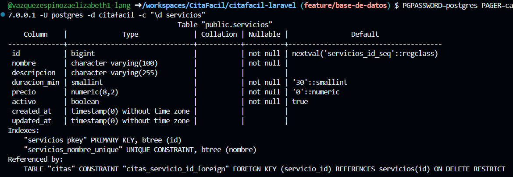
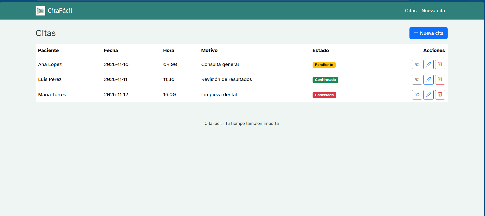
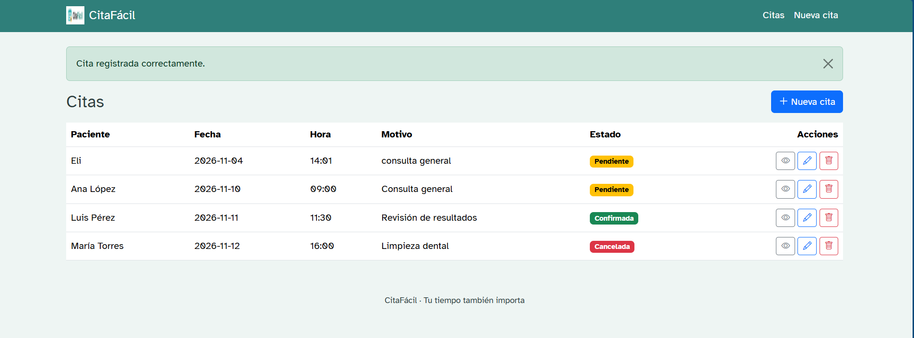
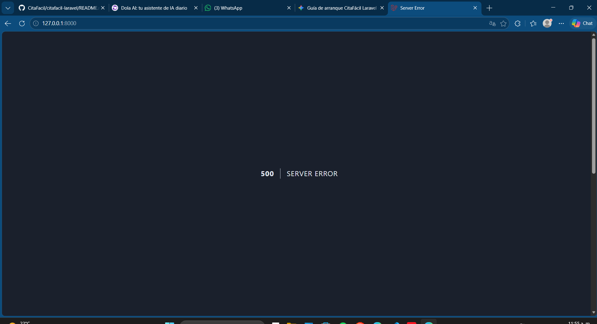
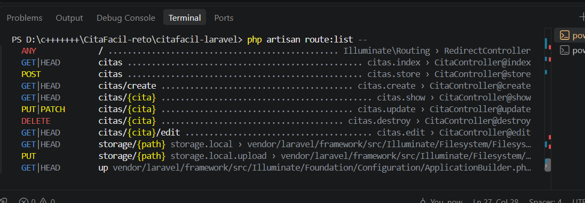
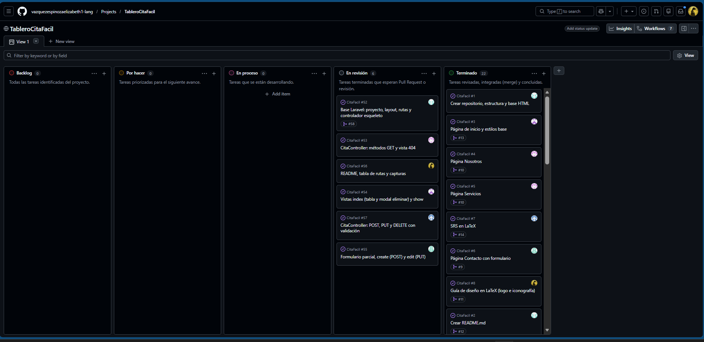

# CitaFácil · Aplicación web de citas (Laravel 12 + PostgreSQL)
*Tu tiempo también importa.*

## 1. Descripción
CitaFácil es una aplicación web para que consultorios pequeños gestionen sus citas: pacientes, servicios, horarios, citas y recordatorios, con inicio de sesión y roles. Está desarrollada con Laravel 12 y PostgreSQL.

> Estado: en desarrollo. Cada integrante completa en este README la sección de su módulo.

## 2. Tecnologías
- PHP 8.2 o superior (con las extensiones `pdo_pgsql` y `pgsql`)
- Laravel 12
- PostgreSQL
- Bootstrap 5
- Composer, Git y GitHub

## 3. Integrantes
| Integrante | Rol | Usuario de GitHub | Módulo | Tarjetas |
|---|---|---|---|---|
| Elizabeth Vázquez Espinoza | Desarrolladora | vazquezespinozaelizabeth1-lang | Entorno y base de datos | T01, T02, T17 |
| Jonathan Corona Téllez | Desarrollador | jonathancorona-rgb | Autenticación, roles y errores | T05, T12, T13 |
| Aram Jael Morales Peña | Desarrollador | arammorales | Citas y panel | T09, T11 |
| Victor Hugo Ramírez | Desarrollador | petevictor1-maker | Servicios, horarios y producción | T07, T08, T14 |
| Luis Ángel Ruiz Bautista | Desarrollador | angelrb2531126237 | Layout, logo y recordatorios | T03, T10, T15 |
| Liam Tonatihu Villanueva Cerón | Desarrollador | LiamVillanueva777 | Componentes, pacientes y seguridad | T04, T06, T16 |

## 4. Instalación

### Requisitos
- PHP 8.2 o superior con `pdo_pgsql` y `pgsql` activos (`php -m | grep -i pgsql`)
- Composer
- PostgreSQL

### Pasos
1. Clonar el repositorio y entrar a la app:
```bash
git clone https://github.com/vazquezespinozaelizabeth1-lang/CitaFacil.git
cd CitaFacil/citafacil-laravel
```
2. Instalar dependencias:
```bash
composer install
```
3. Crear la base de datos `citafacil` en PostgreSQL (con pgAdmin, o con `createdb -U postgres citafacil`).
4. Copiar el archivo de entorno y editarlo:
```bash
cp .env.example .env
```
Abre `.env` y escribe tu usuario y contraseña de PostgreSQL en `DB_USERNAME` y `DB_PASSWORD`. El archivo `.env` es personal y nunca se sube al repositorio.
5. Generar la clave, crear las tablas y cargar los datos de ejemplo:
```bash
php artisan key:generate
php artisan migrate --seed
```
6. Iniciar el servidor:
```bash
php artisan serve
```
Abre http://127.0.0.1:8000

### Problemas comunes
| Error | Solución |
|---|---|
| `could not find driver` | Activa `pdo_pgsql` y `pgsql` en `php.ini` (o instala el paquete `php-pgsql`) y abre una terminal nueva |
| `password authentication failed` | Revisa `DB_USERNAME` y `DB_PASSWORD` en `.env` y ejecuta `php artisan config:clear` |
| `database "citafacil" does not exist` | Crea la base de datos (paso 3) |

## 5. Estructura del proyecto
- `app/Http/Controllers`: controladores delgados, uno por módulo
- `app/Http/Requests`: validación (FormRequest de store y update por módulo)
- `app/Models`: modelos Eloquent con relaciones
- `database/migrations` y `database/seeders`: esquema y datos de ejemplo
- `resources/views`: vistas Blade, una carpeta por módulo, más `layouts` y `partials`
- `routes/web.php`: rutas del sistema

## 6. Módulos
Cada sección la completa su responsable: descripción, rutas, reglas de validación y capturas.

<!-- INICIO: Base de datos -->
### Base de datos

CitaFácil usa PostgreSQL. Todo el esquema se crea con migraciones y se llena con seeders.

    php artisan migrate:fresh --seed

#### Tablas

| Tabla | Descripción | Relaciones |
|---|---|---|
| users | Usuarios del sistema; columna `role` (`admin` o `recepcion`, por defecto `recepcion`) | |
| pacientes | Nombre, teléfono, email (único, opcional) y fecha de nacimiento | Tiene muchas citas |
| servicios | Nombre (único), descripción, duración en minutos, precio `decimal(8,2)` y `activo` (boolean) | Tiene muchas citas |
| horarios | Día de la semana (1 a 7), hora de inicio y fin, `activo`; único por día y hora de inicio | |
| citas | Fecha, hora, motivo y estado (Pendiente, Confirmada o Cancelada) | Pertenece a un paciente y a un servicio; tiene muchos recordatorios |
| recordatorios | Mensaje, fecha de envío, canal (correo, sms o whatsapp) y `enviado` (boolean) | Pertenece a una cita |

#### Política de borrado

- Un paciente o un servicio con citas **no se puede borrar** (`restrictOnDelete`).
- Al borrar una cita se borran sus recordatorios (`cascadeOnDelete`).

#### Datos de ejemplo

El seeder crea un administrador (credenciales en `.env.example`), 8 pacientes, 4 servicios, horarios de lunes a viernes, 10 citas y 5 recordatorios.



<!-- FIN: Base de datos -->

<!-- INICIO: Interfaz y layout -->
### Interfaz y layout
*Pendiente: la completa Angel (T03).*
<!-- FIN: Interfaz y layout -->

<!-- INICIO: Componentes compartidos -->
### Componentes compartidos
*Pendiente: la completa Liam (T04).*
<!-- FIN: Componentes compartidos -->

<!-- INICIO: Autenticación -->
### Autenticación
Este módulo implementa el sistema de registro, inicio de sesión y control de acceso seguro para la aplicación **CitaFácil**.

### Flujo y Características
* **Control de Acceso**: Rutas protegidas mediante los middlewares `guest` (para invitados) y `auth` (para usuarios autenticados).
* **Validación en Español**: Uso de `LoginRequest` y `RegisterRequest` extendiendo de `BaseFormRequest` para asegurar datos únicos y seguros.
* **Seguridad de Contraseñas**: Cifrado automático mediante el casting de Laravel y validación de coincidencia en el registro.
* **Interfaz Adaptable**: Diseño responsivo validado en dispositivos móviles (375 px) y escritorio utilizando Bootstrap 5 y un script de visibilidad de contraseña (`public/js/password.js`).

### Rutas Registradas
| Método | Ruta | Nombre de Ruta | Descripción |
| :--- | :--- | :--- | :--- |
| **GET** | `/login` | `login` | Muestra la vista del formulario de inicio de sesión. |
| **POST** | `/login` | — | Procesa las credenciales y autentica al usuario (con control de intentos / *throttle*). |
| **GET** | `/register` | `register` | Muestra la vista del formulario de registro de nuevos usuarios. |
| **POST** | `/register` | — | Valida y crea un nuevo usuario en la base de datos, iniciando sesión automáticamente. |
| **POST** | `/logout` | `logout` | Cierra la sesión activa del usuario y destruye el token de seguridad. |

### Capturas de Pantalla

**Vista de Registro (`/register`)**


**Vista de Inicio de Sesión (`/login`)**


<!-- INICIO: Roles y permisos -->
### Roles y permisos
*Pendiente: la completa Jonathan (T12).*
<!-- FIN: Roles y permisos -->

<!-- INICIO: Pacientes -->
### Pacientes
*Pendiente: la completa Liam (T06).*
<!-- FIN: Pacientes -->

<!-- INICIO: Servicios -->
### Servicios
*Pendiente: la completa Victor (T07).*
<!-- FIN: Servicios -->

<!-- INICIO: Horarios -->
### Horarios
*Pendiente: la completa Victor (T08).*
<!-- FIN: Horarios -->

<!-- INICIO: Citas -->
### Citas
*Pendiente: la completa Aram (T09).*
<!-- FIN: Citas -->

<!-- INICIO: Recordatorios -->
### Recordatorios
*Pendiente: la completa Angel (T10).*
<!-- FIN: Recordatorios -->

<!-- INICIO: Panel -->
### Panel
*Pendiente: la completa Aram (T11).*
<!-- FIN: Panel -->

<!-- INICIO: Roles -->
### Roles y Permisos
El sistema cuenta con control de acceso basado en roles (RBAC) con dos perfiles principales:

| Rol | Permisos / Acceso |
| :--- | :--- |
| **admin** | Acceso total al sistema, incluyendo la gestión completa (crear, editar, eliminar) de servicios, horarios, pacientes y citas. |
| **recepcion** | Gestión de pacientes, citas y recordatorios; acceso de solo lectura (index y show) a servicios y horarios. |

**Credenciales de prueba (Admin):**
* **Correo:** `corona2306@gmail.com`
* **Contraseña:** `password`
<!-- FIN: Roles -->

### Páginas de error
## Páginas de Error Personalizadas
El sistema cuenta con vistas personalizadas en español para los códigos de error principales (`404`, `419`, `500` y `503`), integradas con el diseño de la aplicación y Bootstrap 5.
Ejemplo de vista 404:
 <!-- (o la ruta donde tengas tu captura) -->

<!-- INICIO: Seguridad -->
### Seguridad
*Pendiente: la completa Liam (T16).*
<!-- FIN: Seguridad -->

<!-- INICIO: Revisión de interfaz -->
### Revisión de interfaz
*Pendiente: la completa Angel (T15).*
<!-- FIN: Revisión de interfaz -->

<!-- INICIO: Despliegue -->
### Despliegue
*Pendiente: la completa Victor (T14).*
<!-- FIN: Despliegue -->

## 7. Tabla de rutas
Se amplía con cada módulo. Rutas actuales:

| Método | URI | Nombre | Controlador@Método | Descripción |
| :--- | :--- | :--- | :--- | :--- |
| `GET` | `/` | — | Redirect | Redirige a la lista de citas (`/citas`) |
| `GET` | `citas` | `citas.index` | `CitaController@index` | Listado de citas |
| `GET` | `citas/create` | `citas.create` | `CitaController@create` | Formulario para agendar una cita |
| `POST` | `citas` | `citas.store` | `CitaController@store` | Guarda la nueva cita |
| `GET` | `citas/{cita}` | `citas.show` | `CitaController@show` | Detalle de una cita |
| `GET` | `citas/{cita}/edit` | `citas.edit` | `CitaController@edit` | Formulario de edición |
| `PUT` | `citas/{cita}` | `citas.update` | `CitaController@update` | Actualiza la cita |
| `DELETE` | `citas/{cita}` | `citas.destroy` | `CitaController@destroy` | Elimina la cita |

## 8. Capturas de pantalla







